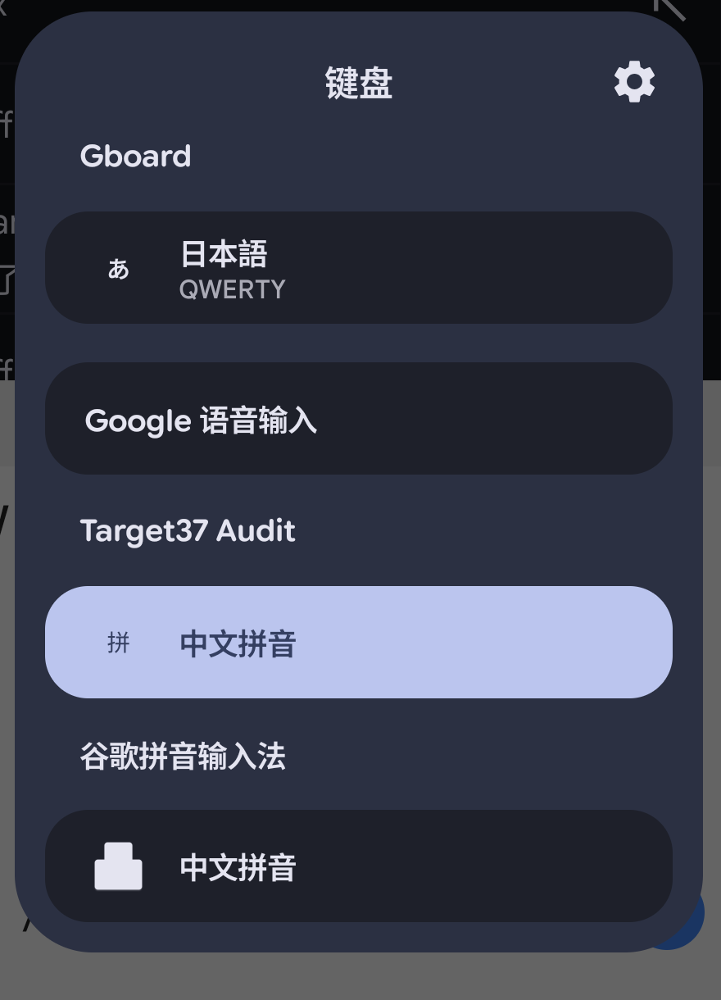

# Android 17 / API 37 适配前调查

设备于 2026-10-12 升级到 Android 17，target 36 已验收并发布为 `v2.1.6`，计划中「等待 target 36 与 Android 17 真机环境」的前置条件解除。

本文只做**适配前调查**：归集官方行为变更、对现有实现做静态审计、列出需要真机实测的项目与下一步。**不提升 target，不改动任何代码。**

## 调查基线

- 当前正式基线 `v2.1.6`，`targetSdkVersion=36`、`minSdkVersion=23`。
- 本机 SDK 已安装 `android-37.2` 平台，其 `build.prop` 为 `ro.build.version.sdk=37`、`sdk_full=37.2`、`release=17`；设备侧报的是 `sdk_full=37.1`。两侧次版本号并不一致，写法结论见下。
- 静态审计基于本次生成的原始 APK 干净解码树 `work/a17-audit/decoded/`（`apktool d -f`，3264 个 smali 文件，无任何补丁）。
- **结论边界**：行为变更判定全部来自静态审计，没有在 API 37 设备上运行验证。真机基线、冒烟与 target 37 提升实测已于 2026-10-12 采集（见 3.2、3.3、3.4），按键音与首次引导两项随后经用户实测确认正常。标注「需实测」的项目必须真机确认后才能写进验收记录。

### 次版本号声明（已定）

Android 17 的 SDK 首次出现 `major.minor` 形式的平台目录（本机 `android-37.2`，设备 `sdk_full=37.1`）。结论是**只有编译侧能写次版本号，目标侧不能**：

| 位置 | 写法 | 依据 |
| --- | --- | --- |
| `apktool.yml` 的 `sdkInfo.targetSdkVersion` | `37`（纯整数） | 平台自带的 `data/res/values/attrs_manifest.xml` 里，`<uses-sdk>` 只定义 `minSdkVersion`、`targetSdkVersion`、`maxSdkVersion` 三个属性，且全文没有次版本号属性 |
| Compose 宿主的 `compileSdk` | `37` | AGP 9.3.1 的 `LibraryExtension` 提供了公开的 `compileSdkMinor` |
| Compose 宿主的 `compileSdkMinor` | `2` | 本机只有 `platforms/android-37.2`，没有 `platforms/android-37`；不写次版本号 AGP 找不到平台 |

依据是本地构件而不是文档：`com.android.build.gradle.LibraryExtension` 在 AGP 9.3.1 与 9.4.0 里都有 `getCompileSdkMinor` / `setCompileSdkMinor`，`CompileSdkDelegate` 带 `compileSdkMinor` 与 `getMinorApiLevel`；同一版本里**没有** `targetSdkMinor`，`TargetSdkSpecImpl` 也不含任何次版本字段，与平台清单属性一致。

项目清单不声明 `compileSdkVersion`，因此 apktool 侧不需要额外处理。设备 `37.1` 与本机平台 `37.2` 是不同构建分支（设备 `CP3A.260905.009`，平台 `CP41.260814.003.B1`），不影响上述写法。

## 一、官方行为变更归集

来源：

- [行为变更：以 Android 17 或更高版本为目标的应用](https://developer.android.com/about/versions/17/behavior-changes-17)
- [行为变更：所有应用](https://developer.android.com/about/versions/17/behavior-changes-all)

### 1.1 仅影响 target 37 及以上的应用

| 变更 | 一句话说明 | 本项目判定 |
| --- | --- | --- |
| `MessageQueue` 无锁实现 | 反射访问 `MessageQueue` 私有字段和方法的代码会被破坏 | 不涉及。全树只用公开的 `MessageQueue.addIdleHandler()` |
| `static final` 字段不可修改 | 反射改 `static final` 抛 `IllegalAccessException`，JNI 改会导致崩溃 | 未发现同类用法，见 2.4 |
| CJKV IME 无障碍支持 | 新增 `TextAttribute.Builder.setTextSuggestionSelected()` 与 `AccessibilityEvent.setTextChangeTypes()` | 可选增强，不构成阻断，见 3.1 |
| ECH 默认启用 | TLS 连接默认启用加密客户端问候 | 不涉及。应用无自有 TLS 连接 |
| `ACCESS_LOCAL_NETWORK` | 局域网访问需要新的运行时权限 | 不涉及。全树无套接字使用。target 36 期间的隐式授权见 3.2 |
| 物理设备隐藏密码 | `show_passwords_physical` 对外接键盘生效 | 不涉及。没有密码输入框 |
| 标准短信 OTP 保护 | 短信验证码延迟 3 小时 | 不涉及。不读短信 |
| Activity 安全性加固 | 后台 Activity 启动限制扩展到 `IntentSender`，需从 `MODE_BACKGROUND_ACTIVITY_START_ALLOWED` 迁移 | 低风险。`IntentSender` 只出现在 GMS 的 `GoogleApiActivity`，Google 账户同步已移除，该路径不可达 |
| 证书透明度默认启用 | TLS 默认要求证书透明度 | 不涉及。同 ECH |
| 更安全的原生动态代码加载 | `System.load()` 加载的原生文件必须只读，否则抛 `UnsatisfiedLinkError` | **需处理**，见 2.1 |
| CP2 限制 PII 字段 | `ContactsContract.Data` 数据视图移除 `ACCOUNT_NAME`、`ACCOUNT_TYPE`、`ACCOUNT_TYPE_AND_DATA_SET` | 不涉及。见 2.5 |
| CP2 严格 SQL 检查 | 无 `READ_CONTACTS` 时查 `Data` 会拒绝不兼容查询 | 不涉及。已声明 `READ_CONTACTS`，且不查 `Data` |
| 后台音频强化 | 后台调用音频 API 静默失败，target 37 要求更严 | **需实测**，见 2.2 |
| 大屏忽略方向限制 | sw ≥ 600 dp 上忽略方向、可调整大小与宽高比限制，退出选项取消 | 不涉及。清单里没有任何 `screenOrientation` |
| RFCOMM `read()` 返回 -1 | 蓝牙套接字读到流末尾返回 `-1` 而不是抛异常 | 不涉及。无蓝牙 |

### 1.2 影响所有运行在 Android 17 上的应用

| 变更 | 一句话说明 | 本项目判定 |
| --- | --- | --- |
| 应用内存限制 | 按设备总 RAM 施加内存上限，超限退出原因记 `REASON_OTHER` 并带 `MemoryLimiter:AnonSwap` | **需实测**，见 2.3 |
| 动态短信密码保护 | WebOTP 格式短信延迟 3 小时 | 不涉及 |
| `usesClearTraffic` 弃用计划 | 未来版本弃用该清单属性 | 不涉及。清单已是 `usesCleartextTraffic="false"` |
| 限制隐式 URI 授权 | Android 18 起不再自动授予 `ACTION_SEND` 等 intent 的 URI 权限 | 不涉及。没有此类 intent |
| 每个应用的密钥库限制 | 单应用密钥数量上限 | 不涉及。不使用 Keystore |
| 阻止跨资料环回流量 | 跨资料回环流量默认被阻断 | 不涉及。没有回环连接 |
| 旋转后恢复默认 IME 可见性 | 应用未处理配置变更时，系统不再恢复 IME 可见性 | **需确认**，见 2.6 |
| 触控板指针捕获 | 指针捕获期间触控板默认传递相对事件 | 不涉及。没有 `requestPointerCapture` |
| 后台音频安全加固 | 同 1.1 对应项 | 同 1.1 |
| 蓝牙自主重新配对 | 配对上下文与 intent 时机变化 | 不涉及 |

## 二、静态审计

### 2.1 `System.load()` 与 DCL-C：唯一明确需要改动的点

原始 APK 的原生库加载器（混淆名 `amd`）是一条三级回退链：

1. `System.loadLibrary(name)`。
2. 失败后尝试 `System.load(<filesDir>/temp_lib_<versionCode>/lib<name>.so)`，读上一次留下的解压产物。
3. 再失败则清掉旧的 `temp_lib_*` 目录，从 `ApplicationInfo.sourceDir` 的 `lib/<CPU_ABI>/lib<name>.so` 用 `ZipFile` 解压到该目录，再 `System.load(<path>)`。

第三步写出的文件由 `FileOutputStream` 直接创建，属主可写。Android 17 要求 target 37 应用经 `System.load()` 加载的原生文件必须是只读，否则抛 `UnsatisfiedLinkError`。

关键判断：**正常路径下 `loadLibrary` 就会成功**。本项目刻意设置 `packaging.jniLibs.useLegacyPackaging = true`，安装时由包管理器解压 `.so`，因此第一级就命中，回退链不会走到第三步。这是**潜在**风险而非当前故障，只有回退被触发时才暴露。

调用方共 10 处，覆盖拼音引擎、英文引擎、HMM 手写与手势、delight4 等模块。

处置方向有两个：给解压产物补 `setReadOnly()`，或者删掉这条回退。倾向后者，但需要先确认没有设备真的会走到它。

**实测确认（见 3.4）**：target 提升到 37 的隔离包在真机上，`nativeloader` 从解压目录直接加载并返回 `ok`，`library_path` 里的 APK 回退段一次都没有用到。也就是说回退链在本项目的打包方式下确实不可达，无需补丁。

### 2.2 按键音

按键音走 `AudioManager.playSoundEffect(int, float)`，调用点在按键音效模块与音量预览控件。键盘可见时进程处于有效生命周期，预期不受后台音频限制影响。**需真机确认按键音与音量预览音仍然发声。**

### 2.3 内存

没有实测数据。输入法进程常驻，运行期加载 5 个原生库与中英文词典、联系人词典。需要采集空载与长时间输入后的 PSS，并检查 `ApplicationExitInfo` 是否出现 `MemoryLimiter:AnonSwap`。

### 2.4 已排除的模式

以下检查全部在干净解码树上做过，结论为「未发现」：

- 无 `sun.misc.Unsafe` 引用，排除基于 Unsafe 的字段写入。
- 无 `Socket`、`ServerSocket`、`InetAddress` 引用，排除局域网与回环。
- `MessageQueue` 只调用公开的 `addIdleHandler`，没有私有字段反射。
- 所有 `java.lang.reflect.Field->set` 调用点都落在**实例字段**：旧 MultiDex 安装器写 `BaseDexClassLoader` 的 `mPaths` / `mFiles`，Guava `Finalizer` 写自己的私有字段，另有反射助手只做 `get`。没有针对平台静态类的反射。
- 清单里没有 `screenOrientation`、没有 `windowSoftInputMode`。
- 没有密码输入框，没有 `ACTION_SEND` / `ACTION_IMAGE_CAPTURE`。
- 权限清单里没有局域网、蓝牙、短信相关项。

### 2.5 联系人查询

联系人词典的投影是 `display_name`、`starred`、`times_contacted`、`last_time_contacted`、`in_visible_group`，查询目标是 `ContactsContract.Contacts.CONTENT_URI`，不是 `ContactsContract.Data`。

因此 CP2 的两项变更都不适用：投影里没有 PII 列，走的也不是 `Data` 表，且应用已经声明 `READ_CONTACTS`。

### 2.6 旋转后恢复 IME 可见性

清单里没有 `windowSoftInputMode`。该变更只影响「应用自己没处理配置变更、又依赖系统恢复键盘」的场景。

静态判定：只有 3 个旧活动声明了 `android:configChanges="orientation|screenLayout|screenSize|smallestScreenSize"`，即 `SettingsActivity`、`ThemeBuilderActivity`、`ThemeEditorActivity`；设置入口 `ModernSettingsActivity` 没有。但设置页里没有常驻输入框，唯一的文本输入在 Rime 同步编辑与清除词典确认两个短生命周期对话框里，都不存在「输入到一半旋转、指望系统把键盘还回来」的流程。**判定不适用。**

## 三、需要真机实测的项目

### 3.1 CJKV IME 无障碍支持（可选增强）

Android 17 为中日韩越输入法新增了两个 API：输入法在设置合成文本时可用 `TextAttribute.Builder.setTextSuggestionSelected()` 说明是否已选中转换候选，无障碍服务再通过 `AccessibilityEvent.getTextChangeTypes()` 读取。目标 37 且使用标准 `TextView` 的应用默认启用。

这对屏幕阅读器朗读候选选择有帮助，但属于**新增能力**而不是兼容性修复。按项目约定，这类改动要满足「默认关闭、关闭时逐入口交回原实现、不新增键盘布局、不改既有按键与候选语义、静态门禁锁定回退入口、真机验收确认原有行为不变」，并且用独立分支。本轮只登记，不实施。

### 3.2 API 37 真机基线（2026-10-12 采集）

设备：Pixel 10 Pro，正式包 `v2.1.6` 为默认输入法。

| 项目 | 值 |
| --- | --- |
| API 级别 / 版本 | `ro.build.version.sdk=37`、`release=17`、`sdk_full=37.1` |
| 构建 | `ro.build.id=CP3A.260905.009`，安全补丁 2026-09-05，`user/release-keys` |
| 内核与页大小 | `6.6.127-android15-8-…-4k`，`getconf PAGESIZE` 返回 4096 |
| 显示 | 1080×2410，density 420 |
| 导航模式 | 三键（`navigation_mode=0`，overlay `navbar.threebutton` 启用） |
| 正式包 | `2.1.6`，versionCode 4520423，minSdk 23，targetSdk 36 |
| 内存 | PSS 约 88 MB，RSS 约 241 MB（Native Heap 30 MB，`.so` mmap 11 MB，GL mtrack 12.6 MB，Other mmap 25.5 MB） |

健康状态：

- `ApplicationExitInfo` 最近一条是 2026-10-12 00:41:24 的 `PACKAGE UPDATED`，升级后没有新的异常退出。
- 更早的三条 `APP CRASH` 发生在 2026-10-08 与 10-10，构建是 Android 16，包是 `2.1.5`，堆栈为已知的手写 `scaleY=NaN`（`axs.a` → `animateKeyboardViewSwitch`），已由 2.1.6 修复，不是 Android 17 回归。
- DropBox 中本包条目同样属于 `2.1.5` 时代。当前 crash buffer 与运行日志没有 `VerifyError`、隐藏 API 拒绝或 `UnsatisfiedLinkError`。

采集时留下的两点疑问已经查清：

- **次版本号错位**：设备 `sdk_full=37.1`、本机平台 `android-37.2`，两者来自不同构建分支（设备 `CP3A.260905.009`，平台 `CP41.260814.003.B1`）。这不影响 target 写法，结论见「调查基线」下的次版本号声明。
- **`ACCESS_LOCAL_NETWORK` 被授予**：本包声明了 `INTERNET` 且 target 36，平台按拆分权限模型给了隐式授权。官方文档原文是「拥有 `INTERNET` 权限的应用将获得 `ACCESS_LOCAL_NETWORK` 的隐式授权，从而允许其保留访问权限。这是暂时的，一旦应用将目标 SDK 提升至 37，此访问权限将默认被阻止」。本项目不使用套接字，提升 target 后该权限被收回不会造成任何功能变化，也不需要在清单里声明。

### 3.3 真机冒烟（2026-10-12 采集）

设备直连后完成。未安装、未切换输入法、未改词典、未动壁纸；唯一的设置改动是临时打开「按键声音」，测完已还原为关闭。收尾时前台、默认输入法、导航模式与按键反馈开关都与开始前一致。

| 项目 | 结果 |
| --- | --- |
| 设置页显示 | 正常。Compose 现代设置页在 Android 17 上渲染完整，四个分区、深色主题、三键导航栏都正确 |
| 键盘几何 | 正常。IME 窗口 frame 为 `[0,172][1080,2410]`，全宽贴底，跳过 172 px 的刘海区 |
| 触摸区域 | 正常。`SkRegion((0,1481,1080,2284))` 的顶部与内容 insets 起点（172+1309=1481）精确对齐，底部留出的 126 px 正是 48 dp 三键导航栏，没有死区 |
| 输入功能 | 正常。32 次敲键累积出完整拼音串，候选栏给出「宝贝龙女仆」「一杯氯霉素」「准备今年入学」等词，组合与候选链路完好 |
| 按键音 | 首次采集**未能验证**，原因是设备处于免打扰（`ZEN_MODE_IMPORTANT_INTERRUPTIONS`），`ringer mode affected streams` 含 `STREAM_SYSTEM`，而键盘音效正走这个流。用户随后临时关闭免打扰复测，**按键音与音量预览音均正常** |
| 内存 | 打开 Compose 设置页并弹出键盘后 PSS 约 203 MB，敲 32 键后 211 MB（+7.6 MB），回到桌面后 184 MB |
| 退出记录 | 无新增。`ApplicationExitInfo` 最新一条仍是当日 00:41:24 的 `PACKAGE UPDATED` |
| 系统音效 | 正常。`KeypressStandard.ogg`、`KeypressDelete.ogg`、`KeypressSpacebar.ogg`、`KeypressReturn.ogg` 全部加载成功，消息队列无积压 |

内存一项对 Android 17 的「应用内存限制」变更（1.2）有意义。本次升级后冷启动、仅键盘时 PSS 约 88 MB，打开设置页后涨到约 203 MB，离开后仍停在约 184 MB，接近翻倍且不会完全归还。主要开销来自 Compose 设置页。升到 target 37 前应确认这条路径不会触达新的内存上限。

另外发现一处与 Android 17 无关但值得确认的现象：`HeaderPlatformHostView.java:133` 是无条件的 `Log.i`，一轮 36 次点击（32 次按键加 4 次候选）产生 32 条 `HeaderPlatformAudit` 记录，成对出现（`native=false idle=true` 与 `native=true idle=false`）。正式包保留这个粒度的日志值得确认是否有意。

### 3.4 target 37 纯提升实测（2026-10-12 采集）

分支 `feat/target-sdk-37`，只改 target 相关声明，不预置任何猜测性补丁。改动面：

| 文件 | 改动 |
| --- | --- |
| `scripts/apply_patches.py` | `apktool.yml` 写 `targetSdkVersion: 37` |
| `version.properties` | `TARGET_SDK=37` |
| `modern-settings/reconstructed-host-prototype/build.gradle.kts` | `compileSdk = 37` 加 `compileSdkMinor = 2` |
| `modern-settings/compose-runtime/build.gradle.kts` | 同上 |
| `modern-settings/gradle.properties` | 新增 `android.suppressUnsupportedCompileSdk=37.2` |
| `scripts/verify_target36.py` | 接受 36 或 37，作为过渡门禁 |
| `scripts/verify_modern_settings_runtime.py` | 断言字符串 `targetSdk = 37` |
| `.github/workflows/build-release.yml`、`docs/build-and-release.md` | 同步平台与版本号 |

构建 `BUILD SUCCESSFUL in 17m 21s`，59 个 task，产物 v1/v2/v3 签名与 16 KiB zipalign 均通过。`compileSdk = 37` 加 `compileSdkMinor = 2` 确实解析到了 `platforms/android-37.2`。

**AGP 警告**：AGP 9.3.1 打印「tested up to compile SDK version 37.1」。本机只有 `platforms/android-37.2`，没有 `android-37` 可退，而设备 `sdk_full` 恰好是 37.1，所以这条警告无法靠选平台规避。以 `android.suppressUnsupportedCompileSdk=37.2` 知情接受，理由写进了 `gradle.properties` 注释：警告语义是「未验证」而非「不支持」，替代方案是完全不按 37 编译；升级 AGP 属独立议题，会牵动可复现门禁。压制后重新配置确认警告消失。

**DCL-C 实测**——本轮提升的核心目的：

| 项目 | 观测 |
| --- | --- |
| 落地形式 | 安装目录下出现 `lib/`，`legacyNativeLibraryDir` 指向它，说明 `useLegacyPackaging = true` 生效，`.so` 由包管理器解压 |
| 文件权限 | `lib/arm64/` 为 `drwxr-xr-x`，6 个 `.so` 全为 `-rwxr-xr-x`，**均无写位**，满足 DCL-C 的只读要求 |
| 命名空间配置 | `target_sdk_version=37`，`library_path` 为两段式：`.../lib/arm64` 在前、`.../base.apk!/lib/arm64-v8a` 在后 |
| 实际加载 | 3 条 `nativeloader: Load /data/app/.../lib/arm64/<lib>.so ... : ok`，全部命中第一段；回退段未被使用 |
| 错误 | 无 `UnsatisfiedLinkError`，无 DCL 相关告警 |

结论：在 `useLegacyPackaging = true` 的打包方式下，DCL-C 回退链**不可达**，2.1 节标为「潜在风险」的判断得到实测支持，无需为它写补丁。

**首次引导**：隔离包 `com.google.android.inputmethod.pinyin.target37test`（`2.1.7-target37.1`，versionCode 4520500，targetSdk 37）为全新安装，冷启动 264 ms 后直接落到 `ModernFirstRunActivity`。引导页渲染正常：标题「设置 Google 拼音输入法」、两项步骤、步骤 1 按钮可用而步骤 2 因未启用而置灰、底部「完成」置灰，深色主题与三键导航均正确。启用、选择、完成三步留给用户自行走完，未代为操作；用户随后走完整个流程，**引导正常**。

### 3.5 输入法切换器图标（已修）

Android 17 的输入法切换器把每个输入法的子类型图标渲染成一个约 24 dp 的单色标记。拼音的子类型原本写着 `android:icon="@mipmap/app_icon"`，指向 144×144 的彩色键盘 PNG（键盘加青绿「拼」字徽章、透明底）。单色化并缩小后细节全丢，只剩「宽矩形叠窄矩形」的轮廓，看上去就是一个方块。

对照：Gboard 给每种语言配一个单色字形，日语是「あ」、简体中文是「拼」，两者都只是单个字符；Google 语音输入没有子类型图标，切换器就只显示文字。与 target 无关，`compat`（target 36）与 `target37test`（target 37）表现一致。

修法照 Gboard：新增 `patches/res/drawable/ic_ime_subtype_pinyin.xml`，把 Noto Sans CJK SC 的「拼」字轮廓做成 24 dp 单色矢量（黑色填充，由系统着色）。

`method.xml` 有四个变体：`res/xml/`、`res/xml-v19/`、`res/xml-television-v13/`、`res/xml-television-v19/`。资源按 API 级别解析，手机上实际加载的是 `xml-v19`，只改基础版不会生效——第一版就是这么漏掉的。四个都要改，`verify_target37.py` 用 `res/xml*/method.xml` 通配断言，禁止任何变体再指回 `@mipmap/app_icon`。

真机复验（Pixel 10 Pro，`2.1.7-target37.3`，versionCode 4520502，长按地球键唤出切换器）：

同一张图里正好构成前后对比：`Target37 Audit`（新包）显示「拼」字，`谷歌拼音输入法`（未重建的 target 36 compat 包）仍是原来的方块剪影。Gboard 的日语项显示「あ」，Google 语音输入没有图标、只有文字，与 3.5 开头的判断一致。

**尺寸校准。**第一版把字形填满整个 24 dp 视口（内边距 2），装机后发现明显偏大：实测「拼」的墨迹为 52×52 px，而 Gboard 的「あ」只有 24×25 px，约 2.1 倍。420 dpi 下 24 dp 合 63 px，20/24 × 63 = 52.5 px，与实测吻合，说明系统确实按 drawable 的固有尺寸渲染，偏大的是字形占视口的比例，不是 drawable 本身被放大。

把生成器的内边距改为 7，字形收进 24 单位视口中的 10 单位方框。重新构建（`2.1.7-target37.4`，versionCode 4520503）后复测：**「あ」24×25 px、「拼」26×25 px，高度比 1.00，两者图标列中心都在 x = 324.5**。拼字本身比假名宽 2 px，属字形差异。

这个值在 `scripts/generate_pinyin_subtype_icon.py` 的 `PADDING` 里，注释记了推导过程，换字形时可重跑。

### 3.6 尚未覆盖

- 旋转后 IME 可见性：静态判定为不适用（见 2.6），未做旋转实测。
- `谷歌拼音输入法`（compat 包）的图标未更新，它走的是另一条构建链，不属于 target 37 适配范围。

## 四、下一步

1. 按键音与首次引导已由用户实测确认正常，见 3.3 与 3.4。
2. ~~从 `master` 创建 `feat/target-sdk-37`，先做纯 target 提升，观察 DCL-C 回退链是否真的触发。~~ **已完成，见 3.4。**回退链未触发，无需补丁。
3. ~~新增 `scripts/verify_target37.py`~~ **已完成**。门禁固定 target 37，以 `useLegacyPackaging = true` 锚定 DCL-C 的只读原生加载，并锁定 1.1 中判定「不涉及」的项：不得声明 `ACCESS_LOCAL_NETWORK`、短信与蓝牙权限，清单里不得出现 `screenOrientation`，smali 全树不得引用 `Socket`、`ServerSocket`、`InetAddress`、`sun.misc.Unsafe`。反向验证已确认把 target 改回 36 会让它失败。`verify_target36.py` 接受 36 或 37，符合既有「自己及以后」的门禁约定（`verify_target35.py` 同样接受 35 与 36），不是过渡态。
4. ~~输入法切换器的子类型图标改用单色「拼」字~~ **已完成并在真机复验通过，见 3.5。**
5. 按 target 29–36 的既有完成条件走构建、静态门禁、真机 ART 与功能回归。

## 相关文档

- [target SDK 分阶段现代化计划](target-sdk-modernization-plan.md)
- [兼容性说明](compatibility-notes.md)
